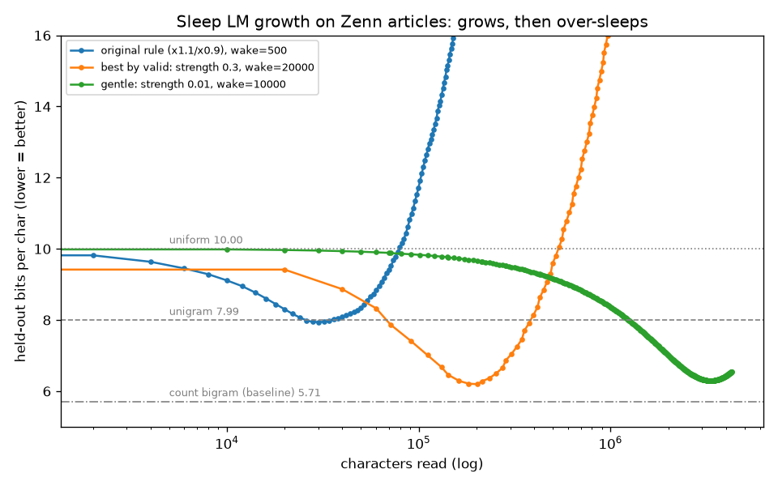
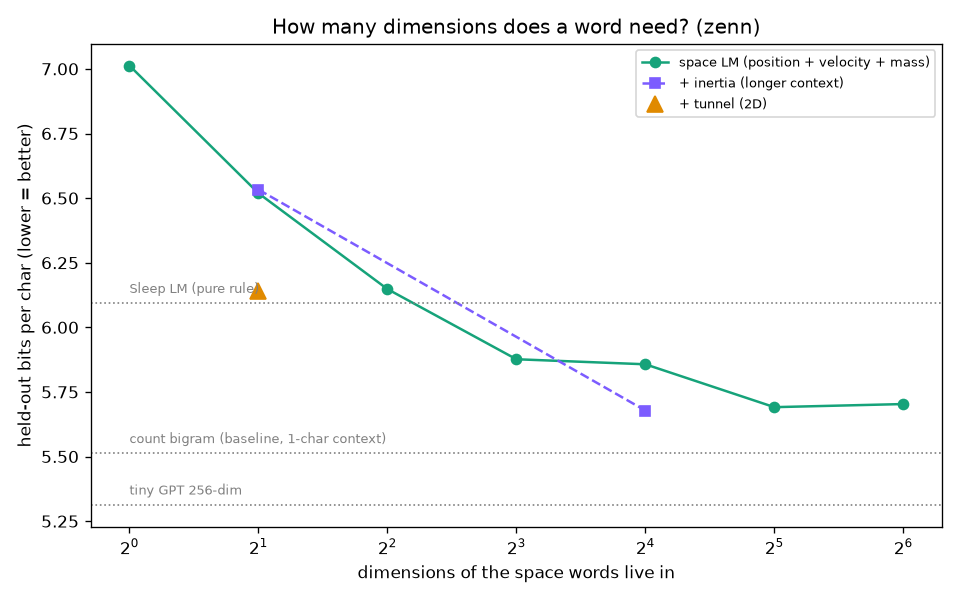
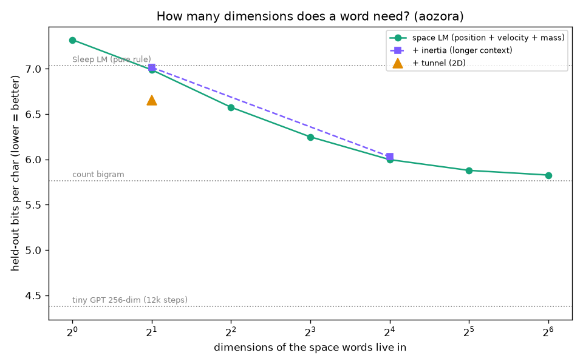
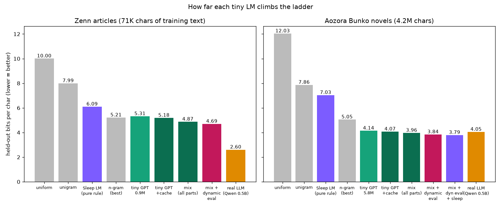

# TinyLM 育成シリーズ —「どこまで育つか」

> 「睡眠」「忘却」「量子トンネル」「伝染」「砂山」など、ちょっと変な仕組みで動く小さな言語モデル（TinyLM）12本に本物の文章を読ませ、
> LLM と同じ物差し（まだ読んでいない文章の bits/char）で「どこまで育つか」を測った実験の記録です。CPU だけで動きます。
>
> 解説記事（Zenn）: https://zenn.dev/emilia_lab/articles/tiny-lm-12-vs-llm

## 動かし方

動作確認: Python 3.12 / torch 2.13（CPU）/ numpy 2.5 / transformers 4.56（`llm_rung.py` のみ）/ matplotlib 3.11（図のみ）

```bash
python -m venv .venv && . .venv/bin/activate
mkdir -p results checkpoints
pip install -r requirements.txt
# 教材1: 青空文庫（aozora_selection.json の335作品を公式 zip から取得。1作品ごとに1秒待つ）
python fetch_aozora.py && python corpus_aozora.py
# 教材2: Zenn 記事（作者自身の記事。手元の Markdown 置き場を ZENN_ARTICLES で指定）
ZENN_ARTICLES=path/to/articles python corpus.py
# 例: 青空文庫で小さい GPT（重みは checkpoints/ に保存）→ 動的評価
LM_CORPUS=aozora python neural_lm.py --modes iid --steps 4000 --d 256 --layers 6 --heads 8 --save checkpoints/aozora.pt
LM_CORPUS=aozora python dyn_eval.py checkpoints/aozora.pt
```

- 教材本文・学習済みの重みは同梱していません（`data/` の本文と `checkpoints/` は git 管理外）。`results/` には実験時の数値と図があります。
- 青空文庫の分割は作品単位（ID 順に10本に1本ずつ test・valid）。異稿・近い作品（例: 「風の又三郎」と「風野又三郎」）は別作品として扱うため、本文の混入を確かめた: test の30字の並び（7字おきに採取）が train に出る割合は 0.00%、valid は 0.05%（どの作品も 2% 未満）。
- **青空文庫の主要な結果を一から再現**するには `tmux new -d -s repro ./reproduce_aozora.sh`（取得 → はしご → GPT 24000/48000回 → キャッシュ → 全部混ぜ → 動的評価 → 睡眠＋動的評価 → LLM を依存の順に実行。出力は `results_repro/`、同梱の `results/` は上書きしない。合計で CPU 数十時間）。実行中は `results/` を一時的に `results_repro/` へのリンクに差し替えるので、**他の実験と同時に動かさないでください**。強制終了で `results_shipped/` が残ったときは、`results` が `results_repro/` へのリンクであることを `ls -l results` で確かめてから `rm results && mv results_shipped results` で元に戻せます。取得した教材が実験時と同じかは `cd data/aozora && sha256sum -c ../../aozora_sha256.txt` で確かめられます。
- `run_*.sh` は実験時に使った実行記録です（Zenn 教材も前提にしています）。各段は**結果ファイルがあれば飛ばす**作りなので、同梱の `results/` があるとそのまま飛ばされます。
- 動的評価・睡眠＋動的評価は、各位置の対数確率（`.npy`、git 管理外）も作ります。値の JSON があっても `.npy` が無い設定は計算し直します。
- Zenn の教材は作者自身の記事集合（版を同梱していない）なので、第三者が Zenn の数値をそのまま再現することはできません。青空文庫の数値は `fetch_aozora.py` で同じ作品を取得すれば再現できます（乱数・CPU による小さな差は除く）。
- ライセンス: MIT（`LICENSE`）は**このリポジトリのコードと文書**に適用されます。青空文庫の作品、Zenn の元記事、比較に使った Qwen2.5-0.5B（Apache-2.0）の権利・ライセンスはそれぞれのものです。


作者が以前に作った、ちょっと変な仕組みの小さな言語モデル（TinyLM）12本を1本ずつ「本物の文章を読ませて」育て、
LLM と同じ物差し（**まだ読んでいない記事の bits/char**、小さいほど良い）で「はしごの何段目まで登れるか」を測る。

- コーパス: ねこさんの Zenn 記事 36本（`corpus.py`、ローカルのみ・`data/` は git 管理外）。記事単位で train 25 / valid 4 / test 7 に分割。文字単位。語彙 1,025字＋<unk>。
- はしご（test bits/char）: 段0 一様 10.00 → 段1 ユニグラム 7.99 → 段2 数え上げバイグラム 5.71（add-k、k は valid で選択）→ … → LLM
- 選び方: 止めどき・設定の比較はすべて valid で決め、test は報告だけ（リーク防止）。

## 第1弾: 睡眠LM（2026-11-21）

`sleep_growth.py` / `sweep_sleep.py` / `plot_sleep.py`、結果は `results/`。

原典との違いは1点だけ：覚醒中に自分で喋る代わりに記事を読む。睡眠ルール（その覚醒で使った遷移 ×(1+s)、使わなかった遷移 ×(1−s)、行ごとに再正規化。原典は s=0.1）はそのまま。構造上「直前1文字→次の1文字」なので、比較基準は段2（数え上げバイグラム）。



### 結果
- **到達点: test 6.197 bits/char**（valid で選んだ最良設定 s=0.3・覚醒2万字、約20万字読んだ時点）。段1（7.99）は越え、段2（5.71）には届かない。段1→段2 の距離の約79%。
- **多くの設定で「寝すぎて」崩れる**。24設定中20設定で最良点を過ぎると bits/char が悪化し（16設定は最終的に一様分布 10.0 より悪い。原典ルール・覚醒500字では最終 69）。使われた遷移を毎晩 ×1.1 し続けるので、確率が一部の遷移に集中しすぎて、読んだことのない並びに極端に弱くなる。原典 v0.1 で見えていた「レパートリーが狭まる」の極端な形。
- **覚醒が長いほど育つ**（2万字まで）。睡眠ルールは「使ったか否か」の二値なので、1回の覚醒の中の回数の多寡は捨てられる。覚醒を長くして回数を増やすと、「何晩に1回使われたか」が頻度の代わりになる。ただし全文（7.1万字）を1回の覚醒にすると、1晩ごとの差がなくなって逆に悪化（6.95）。
- 睡眠を弱くする（s=0.01）と崩れるのが遅くなるだけで、到達点はほぼ同じ（6.30）。
- 出力は全段階で文字の羅列（温度1のサンプリング）。崩れた後の出力は局所的には単語らしく見えるのに、bits/char は 62 と最悪。「見た目の流暢さ」と「予測の良さ」は別物、という観察。

### 判定
睡眠LMは **段1.8 あたりで頭打ち**。LLM 方向に伸ばすには、(1) 寝すぎを止める仕組み（自分で止めどきを知る、または消えかけの遷移に下限）と、(2) 直前1文字より長い文脈、の両方が要る。どちらも原典の仕組みの外側なので、v0.3 で足すかは要相談。

学習データは小さい（7万字）。より大きなコーパスでの頭打ち位置は未検証。

## 第1弾の続き: 睡眠LM v0.3（長い文脈）— 2026-11-21

`sleep_ngram.py`、結果 `results/sleep_ngram.json`。行の単位を「直前1文字」から「直前 k 文字」に広げ、見たことのない文字は短い文脈に任せる（バックオフ）。睡眠ルールは同じ。

| 文脈 | 睡眠LM 最良 test bpc | 数え上げ（補間つき絶対値割引） |
|---|---|---|
| 1文字（2-gram） | **6.09** | 5.51 |
| 2文字（3-gram） | 6.29 | 5.21 |
| 3文字（4-gram） | 6.54 | 5.20 |
| 4文字（5-gram） | 6.67 | 5.25 |

（睡眠LMは各文脈で 強さ{0.03,0.1,0.3}×覚醒{5000,2万字} を valid で選んだ値）

- **文脈を延ばすほど悪化**。睡眠ルールは「その晩に使ったか否か」しか見ないので、1回しか見ていない珍しい並びも毎晩見る並びも同じ勢い（×(1+s)）で強化する。長い文脈は珍しい並びばかりなので、根拠の薄い確信が一気に増えて崩れる。
- 純粋な睡眠ルールの到達点は、今回試した範囲では **6.09（段1.8）**。ここから上は「何回見たか」を数える仕組みが要る（＝睡眠ルールの外側）。
- 前節の比較基準 5.71（同じ文脈長でも推定・平滑化の仕方で値は変わる）は add-k の2-gram。補間つき絶対値割引の2-gramは 5.51 で、こちらを正式なはしごとする。

## 大きい教材: 青空文庫（2026-11-21）

`corpus_aozora.py`。夏目漱石・宮沢賢治・芥川竜之介の新字新仮名・著作権なし 335作品（公式インデックスCSVから選定、1秒間隔で取得、`data/` は git 管理外）。作品単位で train 269 / valid 33 / test 33、学習用 4,247,586字。

数え上げのはしご（`ladder_scale.py`、語彙は全量から1回だけ作り全ての量で共通＝4,190字）:

| 教材 | 2-gram | 3-gram | 4-gram | 5-gram |
|---|---|---|---|---|
| 7万字 | 6.670 | **6.550** | 6.649 | 6.722 |
| 30万字 | 6.362 | **6.138** | 6.241 | 6.345 |
| 100万字 | 6.023 | **5.593** | 5.639 | 5.749 |
| 424万字 | 5.766 | 5.095 | **5.048** | 5.147 |

教材が増えるほど下がり、使える文脈も長くなる（424万字で初めて4-gramが3-gramを抜く）。小説は技術記事より字の種類が多く、同じ7万字でも Zenn（5.21）より難しい。

## 第2段: ニューラル睡眠LM v1.0（Zenn、2026-11-21）

`neural_lm.py`、結果 `results/neural_zenn.json`。文字単位の小さい GPT（4層・d=128・文脈128字・94万パラメータ、CPU）。総更新3000回でそろえ、valid で止めどきを選んで test を報告。

| 学び方 | test bpc |
|---|---|
| iid（全文からランダムに切り出す＝ふつうの学習） | 5.363 |
| stream（記事を頭から順に読むだけ、読み終えた所には戻らない） | 5.337 |
| **sleep**（stream と同じ順で読み、毎晩それまで読んだ所からリプレイ） | **5.313** |
| 参考: 数え上げ 3-gram | 5.207 |
| 参考: 睡眠LM v0.2（純粋な睡眠ルール） | 6.093 |

- ニューラル化で睡眠LMより約0.8ビット改善。文も単語として読める部分が増える。
- 3つの差は 0.05 以内で、乱数1通りの比較。「睡眠が効いた」とは言えない（全文を約10周しているので、stream でも忘れの害が小さい）。
- 7万字では数え上げ3-gramに届かない。iid は1400回目で最良になり、その後は丸暗記で悪化＝教材不足。

## 第3段: 青空文庫で小さい GPT（2026-11-21）

6層・d=256・8ヘッド・文脈128字・**584万パラメータ**、4000回更新（CPU 75分）、途中評価は valid 先頭10万字。

- **test 4.916 bits/char — 数え上げのはしご最良（4-gram 5.048）を初めて越えた。**
- 出力例（温度0.8）:「いや、いいえ。あたしはきっと顔をしておきました」と云っていたのです。／「なるほど、お父さんは奥さんにお父さまはおれにその時お蔭でまだ行きますからね。」— 意味は通らないが、会話の括弧・語尾・「云って」等の文体は成立。
- 4000回でも valid は下がり続けていた（4.736→4.728→4.725）＝このモデルの天井はまだ先。12000回の長時間版を実行中（nice 19・4スレッド）。

## 最上段: 本物の LLM（2026-11-22）

`llm_rung.py`。Qwen/Qwen2.5-0.5B（5億パラメータ、Apache-2.0）を CPU で、同じ test 全文の bits/char で測定（1024トークン窓・512ずらし・重なりは数えない）。

| 教材 | 自作の最良 | Qwen2.5-0.5B |
|---|---|---|
| Zenn（test 23,209字） | 5.207（数え上げ3-gram）／ GPT 5.313 | **2.602** |
| 青空文庫（test 315,273字） | 4.916（GPT 584万param） | **4.045** |

注意（どちらに有利かが逆向きの2つ）:
- 青空文庫・公開済み Zenn 記事は LLM の事前学習に含まれている可能性が高い（LLM 有利）。
- 自作モデルは学習用に2回未満しか出ない字を `<unk>` にまとめて当てている。LLM は全ての字を正確に当てる（自作有利）。

## 睡眠LM（純粋な睡眠ルール）を青空文庫で（2026-11-22）

`sweep_sleep_aozora.py`、結果 `results/sleep_aozora.json`。強さ{0.3,0.1,0.03}×覚醒{2万,10万,40万字}、valid で選択。

- **最良 test 7.034**（s=0.03・覚醒10万字）。ユニグラム 7.86 → 数え上げ2-gram 5.77 の距離の約40%。Zenn（約79%）より相対的に弱い：語彙が4,190字と多く、「使ったか否か」の二値情報ではさらに足りない。
- 寝すぎて崩れるのも同じ（s=0.3・覚醒2万字は最終 294）。出力は難しい漢字の羅列にたまに単語（「同時に」「内心」）が混じる程度。

## 第4弾: 記憶系（忘却LM・免疫LM）（2026-11-22）

`memory_lm.py`、結果 `results/memory_{zenn,aozora}.json`。設計は `DESIGN_next.md` の A。
原典の仕組み（痕跡/抗体が字を出すと+1・半減期 H で減衰、スコアに掛け算/割り算）はそのまま、遷移重みを教材の数え上げ n-gram（Zenn 3-gram / 青空 4-gram）に差し替え。(β,H)・(強さ,H) を valid で格子探索（青空は valid 先頭5万字）。

| | Zenn test | 青空文庫 test |
|---|---|---|
| 土台 n-gram | 5.207 | 5.048 |
| 忘却LM（原典の掛け算の形、β=0.1・H=100） | 5.198 | 5.048 |
| 免疫LM（最良は最弱設定＝ほぼ土台） | 5.208 | 5.046 |
| **参考: 混ぜ合わせ型キャッシュ** P=(1−λ)P0+λ×痕跡分布（λ=0.1、H=300 / 3000） | **5.048** | **4.787** |
| 比較: 小さい GPT | 5.313 | 4.916（4000回） |

- 予想の向きは当たった（忘却＝わずかに良い、免疫＝強めるほど悪化：valid で最悪 Zenn 4.93 / 青空 5.08）。ただし原典の形では**ほとんど育たない**（test 差 0.01 以下）。
- **弱いのは「文字単位」ではなく「掛け算の形」**。痕跡は頻出字（の・は）にも溜まり、それが土台の確率に掛かって分布を歪める。混ぜ合わせ型は最近の字に別枠の確率を割り当てるので歪めない。
- 混ぜ合わせ型キャッシュを足した数え上げ n-gram は、**両方の教材で小さい GPT を越えた**（青空 4.787 vs 4.916）。効く半減期は Zenn 300字・青空 3000字（小説は人物名や言葉づかいが章をまたいで続く）。
- 混ぜ合わせ型は原典の仕組みではないので「忘却LMが育った」とは言わない。「記憶という発想は正しく、原典の掛け方が弱かった」が結論。

## 第5弾: 空間系（共鳴・力学系・E=mc²・相対論・量子トンネル）— Zenn（2026-11-22）

`space_lm.py`、結果 `results/space_zenn.json`、図 `results/space_dims_zenn.png`。設計は `DESIGN_next.md` の B。
物理シミュレーションは確率を出さないので確率版を作った: P(次=i|前=j) ∝ m_i·exp(−|x_i − (x_j+u_j)|²)（位置 x・速度 u・質量 m を勾配法で学習）。各家族の要素を1つずつ足して効き目を分離。valid で止めどき選択。



次元のはしご（test）: 1次元 7.01 → 2次元 6.52 → 4次元 6.15 → 8次元 5.88 → 16次元 5.86 → 32次元 **5.69** → 64次元 5.70（比較基準の数え上げ2-gram 5.51）。
- 4次元で睡眠LM（6.09）とほぼ並び、32次元で比較基準の手前0.18。原典の2次元は1,000字を並べるには窮屈。64次元で頭打ちなのは教材不足（50回程度で丸暗記が始まる）。

要素ごとの効き目（2次元の力学系を土台に1つずつ）:

| 要素 | test | 効き目 | 学習で決まった値 |
|---|---|---|---|
| 土台（位置＋速度＋質量） | 6.519 | — | |
| 速度なし（素の重力） | 6.843 | 速度の価値 0.32 | |
| 質量なし | 7.114 | 質量の価値 0.59 | |
| 共鳴（1次元＋倍音） | 6.947 | 1次元の土台 7.013 より 0.07 良い | |
| E=mc²（出すのにコスト） | 6.519 | なし | c² → 0.03（要らないと学んだ） |
| 相対論（重い字のそばで留まる） | 6.516 | ほぼなし | γ=0.31 |
| **量子トンネル（たまに遠くへ跳ぶ）** | **6.142** | **0.38** | 跳ぶ確率 29% |
| 慣性（2次元） | 6.533 | なし | ρ → 0.02（使わないと学んだ） |
| **慣性（16次元）** | **5.678** | 16次元の土台 5.857 より 0.18 | ρ=0.20 |

- 一番効くのは**トンネル**：2次元では届かない字を「たまに遠くへ跳ぶ」で補う。
- E=mc² は学習が係数を小さく（c²→0.03）し効果なし。相対論も改善はごくわずか（係数は Zenn γ=0.31）＝今回の定式化では言葉の予測にほぼ効かない。
- 慣性（過去を引きずる＝長い文脈）は、空間が広いときだけ効く。2次元で過去を混ぜると字の区別が潰れる。

### 青空文庫版（2026-11-22）

結果 `results/space_aozora.json`、図 `results/space_dims_aozora.png`（valid は先頭10万字で止めどき選択）。



次元のはしご（test）: 1次元 7.32 → 2次元 6.99 → 4次元 6.58 → 8次元 6.25 → 16次元 6.00 → 32次元 5.88 → 64次元 **5.83**（比較基準の数え上げ2-gram 5.77）。
- 2次元でちょうど睡眠LM（7.03）と並ぶ。教材が60倍あるので Zenn と違い64次元まで下がり続け、比較基準の手前0.06まで来た。

| 要素（2次元の土台 6.989 に1つずつ） | 青空 test | Zenn test | 学習で決まった値（青空） |
|---|---|---|---|
| 速度なし | 7.422（価値 0.43） | 6.843 | |
| 質量なし | 7.238（価値 0.25） | 7.114 | |
| 共鳴（1次元＋倍音） | 7.402（1次元土台 7.320 より悪い） | 6.947 | |
| E=mc² | 6.989（効果なし） | 6.519 | c² → 0.03 |
| 相対論 | 6.979（0.01） | 6.516 | γ=1.04 |
| **量子トンネル** | **6.658（0.33）** | **6.142** | 跳ぶ確率 50% |
| 慣性（2次元） | 7.016（なし） | 6.533 | ρ → 0.01 |
| 慣性（16次元） | 6.031（16次元土台 6.00 より悪い） | 5.678 | ρ=0.12 |

- **両方の教材で同じ結論**: 一番効くのはトンネル、E=mc² は学習が係数を小さくし（効果なし）、相対論は係数こそ残るが改善はごく小さい（青空 γ=1.04・改善 0.01）、2次元の慣性は使われない。
- 違い: 青空では速度の価値が質量より大きい（語彙が多く「を→動詞」のような向きの区別がより重要）。共鳴の倍音と16次元の慣性は青空では効かなかった（Zenn の小さな改善は教材の小ささ由来の可能性）。

## ニューラル睡眠を青空文庫で（2026-11-22）

`neural_lm.py --modes stream,sleep`（584万param・4000回、iid と同条件）、結果 `results/neural_aozora_sleep.json`。

| 読み方 | 青空 test |
|---|---|
| iid（ばらばらに読む） | **4.916** |
| stream（頭から順に読む・戻らない） | 5.295 |
| sleep（順に読む＋毎晩これまでの所をリプレイ） | 5.053 |

- Zenn では差が誤差程度だったが、作家・作品で文体が大きく変わる青空では**順読みは 0.38 悪化**（最後に読んだ作家に寄る）。**睡眠リプレイがその約6割（0.24）を取り戻した**。
- シリーズの睡眠の結論: 睡眠ルール単体で LM を作ると頭打ち。だが順に読む学習者に足すと「忘却の回復」として確かに効く。

## 青空文庫 GPT 24000回→48000回 ＋ GPT＋混ぜ合わせ型キャッシュ（2026-11-22〜23）

落ちても続くよう `run_pipeline.sh` を tmux で実行（各段は出力があれば飛ばす）。`neural_lm.py --save` で重みを保存し、`gpt_cache.py` で
P = (1−λ)·P_GPT + λ·痕跡/Σ痕跡（第4弾の混ぜ合わせ型キャッシュをそのまま GPT に足す）。(λ, H) は valid（青空は先頭30万字）で選択、λ=0 は GPT 単体と完全一致。

| | Zenn test | 青空文庫 test |
|---|---|---|
| 小さい GPT（iid） | 5.363（94万param・3000回） | **4.139**（584万param・48000回、13.9時間。24000回 4.197・12000回 4.379） |
| **GPT＋キャッシュ** | **5.185**（λ=0.1・H=300） | **4.069**（48000回・λ=0.05・H=300。24000回は 4.136） |
| 参考: 数え上げ n-gram＋キャッシュ | 5.048 | 4.787 |
| 本物の LLM（Qwen2.5-0.5B） | 2.602 | **4.045** |



- **青空文庫で自作モデルと LLM の差は 0.024 ビットまで縮んだ**（4000回 0.87 → 12000回 0.33 → 24000回 0.15 → 48000回 0.094 → ＋キャッシュ **0.024**）。届かず。
- 48000回の最良は step 46000（valid 3.969）。倍の学習で 0.058 しか下がらず（12000→24000回は 0.18 下がった）、584万param・教材量では天井が近い。次の一押しは学習回数より教材かモデルの大きさ。
- キャッシュの上乗せは GPT では小さい（青空 0.06、Zenn 0.18）。n-gram（青空 0.26）より小さいのは、GPT が文脈128字以内の繰り返しを自分でもう拾えているため。効く半減期も 300字と短い。
- Zenn は教材 7万字が小さすぎて GPT が伸びず、n-gram＋キャッシュ（5.048）が自作の最良のまま。LLM（2.60）との差は教材量の差が一因と考えるが、分野・モデル規模の影響とは切り分けていない。
- 出力例（24000回、温度0.8）:「今にいらっしゃるのよ。あたしがまだお早うございますわ。」／男はほう息もつけずに、しまいには、とんとんと答えない顔をして、茫然と…

> ログの見かた: `mix_all_*.log` 冒頭の `divide by zero` 警告は、キャッシュ**単体**の成績（確率0の字があり無限大＝JSON では null）を計算したときのもので、混ぜた後の値は有限です。`space_aozora.log` 末尾の作図エラーは実験時の環境の問題で、図はその後に作り直し済み（`results/space_dims_aozora.png`）。

> **訂正（2026-11-23、Codex 公開前レビューで発見）**: `gpt_cache.py` の遅延キャッシュは分母が1字ぶん減衰しておらず、確率の和が 1 でなく dec（H=300 で 0.9977）だった（自作側に不利な向き）。修正して gpt_cache / mix_all を全部再計算（実験時の一回きりのスクリプト `run_fix1.sh`、公開版には同梱しない）→ 変化は小数第4位のみ（例 4.0686、3.8388）で、下の表の値（小数第3位）はすべて不変。第4〜7弾の memory_lm / family_c / family_d は痕跡と合計を同時刻で更新しており該当なし。

## 全部混ぜ — この評価条件で Qwen2.5-0.5B の bits/char を下回る（2026-11-23）

`mix_all.py`: 自作の部品を線形に混ぜる P = Σ w_k·P_k。重みは valid（先頭30万字）で EM、test は選んだ重みで評価（test の値は選択に使わない）。

| 青空文庫 test | bits/char |
|---|---|
| GPT 48000回 単体 | 4.139 |
| GPT 48000回＋キャッシュ | 4.069 |
| **全部混ぜ**（GPT 48k 0.51・GPT 24k 0.35・4-gram 0.10・キャッシュ H=300 0.03） | **3.963** |
| 本物の LLM（Qwen2.5-0.5B） | 4.045 |

- **この評価条件で、自作モデルの bits/char が Qwen2.5-0.5B を 0.082 下回った**（ただし青空文庫の上で、LLM は今回の train による追加学習をしていない汎用モデル。こちらは同じ作家群の train で育てた専用品）。
- 1つ抜くと: GPT 48k 抜き 4.085 / **GPT 24k 抜き 4.023** / 4-gram 抜き 3.984 / キャッシュ H=300 抜き 3.978。48000回版に足した部品の中では 24000回版（**別に学習した**モデル。48000回の学習の途中ではない＝OneCycleLR の学習率スケジュールも別）の寄与が最大＝2体の GPT は違う間違え方をしている。n-gram とキャッシュもそれぞれ約 0.02 ずつ。

## 動的評価 — 読みながら学ぶ GPT（2026-11-23）

`dyn_eval.py`（`run_dyn.sh` を tmux で）: test を前から窓ごとに ①今の重みで採点 → ②その窓で Adam 1歩。採点は必ず学習の前なので先読みなし（lr=0 は静的評価と一致を確認）。
学習率は valid（先頭30万字）で 1e-5〜3e-4 から選択 → どちらの GPT も 3e-5。

| 青空文庫 test | 静的 | 動的 |
|---|---|---|
| GPT 48000回 | 4.139 | **3.905** |
| GPT 24000回 | 4.197 | 4.012 |
| 全部混ぜ（動的 GPT 48k 0.63・24k 0.29・4-gram 0.07・キャッシュ 0.01） | 3.963 | **3.839** |
| 本物の LLM（Qwen2.5-0.5B） | 4.045 | — |

- **動的評価だけで GPT 単体が Qwen2.5-0.5B の静的評価値（4.045）を下回った**（−0.23）。キャッシュ（＋0.07）の3倍以上効く＝「出た字を覚える」より「読んだ文で重みごと馴染む」方が強い。睡眠・記憶系で探していた「読みながら変わる」の本命の形。
- 動的にするとキャッシュの出番はほぼ消える（重み 0.01、抜いても +0.006）。2体混ぜは依然 0.03 効く。
- 最終: **3.839**（この評価条件で Qwen2.5-0.5B の 4.045 を 0.21 下回る。但し書きは前節と同じ＝青空専用に育てた側の土俵）。

### 睡眠＋動的評価（2026-11-24）

`sleep_dyn.py`（`run_sleep_dyn.sh` を tmux で）: 動的評価（昼）に「夜」を足す。N 窓ごとに R 歩、ランダムな4窓のバッチで読み返し学習（学習率は昼と同じ 3e-5）。
読み返し元は **past**（test のうち採点済みの部分＝今日読んだ所）か **train**（学習用教材＝昔覚えた知識）。R=0 は動的評価と一致（確認済み）。(源, N, R) は valid で選択（12通り）。

| 青空文庫 test | 動的評価のみ | ＋夜の読み返し（train・N=16 窓ごと・R=16 歩） |
|---|---|---|
| GPT 48000回 | 3.905 | **3.876** |
| GPT 24000回 | 4.012 | **3.976** |
| 全部混ぜ（48k 0.60・24k 0.32・4-gram 0.06・キャッシュ 0.01） | 3.839 | **3.791** |

- **効いたのは昔の教材の読み返し（train）**。今日読んだ所の読み返し（past）はほぼ効かない（valid で −0.003 以下）。動的評価は読み進めるほど直近の文体に寄り、元の知識を少しずつ忘れる。夜に元の教材を読み返すとその忘れを防げる＝ニューラル睡眠（順読みの忘れを約6割回復）と同じ構図。
- 夜は多く・長いほど良く、最良は格子の端（N=16・R=16）。まだ伸びる可能性あり（計算量は約2.5倍）。
- 最終: **3.791**（この評価条件で Qwen2.5-0.5B の 4.045 を 0.25 下回る）。

### Zenn でも（2026-11-23）

GPT は1体（94万param・3000回）なので混ぜるのは GPT・3-gram・キャッシュ。学習率は 1e-5〜1e-2 から valid で 3e-4（青空の10倍）。

| Zenn test | 静的 | 動的 |
|---|---|---|
| GPT 単体 | 5.363 | **4.966** |
| 全部混ぜ | 4.869（GPT 0.41・3-gram 0.54・キャッシュ 0.05） | **4.695**（動的 GPT 0.57・3-gram 0.42） |
| 本物の LLM | 2.602 | — |

- 自作の最良が 5.048（n-gram＋キャッシュ）→ **4.695**（−0.35）。動的評価の効きは青空より大きい（GPT 単体 −0.40 vs −0.23）、最適な学習率も10倍。教材が小さい（7万字）ほど「読みながら学ぶ」の比重が上がる。
- それでも LLM との差は 2.09。教材の少なさ（7万字）が一因と考えるが、Zenn と青空では分野も GPT の大きさ（94万 vs 584万param）も違うので切り分けられていない。

## 第6弾: 集団・流行系（伝染LM・生態系LM）（2026-11-22）

`family_c.py`、結果 `results/family_c_{zenn,aozora}.json`。設計は `DESIGN_next.md` の C。
ネットワークは学習用本文の共起（±50字）の PMI から作る。伝染＝正の PMI を行正規化した感染ネットワーク、生態系＝符号つき PMI（＋共生・−競争）。
土台は第4弾と同じ数え上げ n-gram、A＝第4弾の混ぜ合わせ型キャッシュ（λ・H は第4弾で選んだ値に固定）。

| | Zenn test | 青空文庫 test |
|---|---|---|
| 土台 n-gram | 5.207 | 5.048 |
| A: 混ぜ合わせ型キャッシュ（出た字そのもの） | 5.048 | 4.787 |
| C1 伝染・原典の形 P∝P0·(1+β·感染度) | 5.199 | 5.047 |
| **C2 A＋感染分布を混ぜる（関連する字に広がる）** | **5.028** | **4.758** |
| C3 生態系（P0 を共生・競争の圧力で傾ける＋A） | 5.049 | 4.786 |

- **広がり（伝染）の手柄は Zenn 0.020・青空 0.029**。予想どおり小説（人物・場面が続く）のほうが効く。数え上げ系の自作最良を両教材で更新。
- 原典の掛け算の形（C1）はほぼ効かない（第4弾の忘却LMと同じ構図）。生態系の競争（負の相互作用）は効かない。

## 第7弾: 制約系（化学反応LM・砂山LM）（2026-11-22）

`family_d.py`、結果 `results/family_d_{zenn,aozora}.json`。設計は `DESIGN_next.md` の D。

| | Zenn test | 青空文庫 test | 学習で選ばれた値 |
|---|---|---|---|
| 土台 n-gram | 5.207 | 5.048 | |
| D1 化学（字ごとの在庫が尽きる） | 5.210 | 5.048 | 青空は α=0（使わない） |
| D2 化学（文字種で原子を共有） | 5.207 | 5.045 | Zenn は α=0 |
| D3 砂山（予想された分だけ砂が積もり、出た字の山が崩れて雪崩） | 5.196 | 5.048 | Zenn κ=−0.03、青空 κ=0 |
| D3＋A | 5.043 | 4.787 | |

- 予想どおり**独自の手柄はほぼなし**（最大 0.011）。在庫が尽きる＝出た字を出にくくする＝免疫LMと同じ向きで、言葉は逆（出た字は続けて出やすい）。
- 砂山の向きは負（「予想されたのにまだ出ない字は、むしろ出にくい」）。溜まったら出る、という砂山の直観とは逆。

## 12本の到達点（まとめ）

| 家族 | 子 | 原典の形で育てた最良（青空 test） | 一言 |
|---|---|---|---|
| 睡眠 | 睡眠LM | 7.03（Zenn 6.09） | 純粋ルールは段1.8で頭打ち・寝すぎで崩壊。GPT に足すと順読みの忘却を約6割回復、動的評価に足すと −0.03〜0.05 |
| 記憶 | 忘却LM / 免疫LM | 5.048 / 5.046（土台並み） | 掛け算の形が弱い。混ぜ合わせ型にすると 4.787 |
| 空間 | 力学系・共鳴・E=mc²・相対論・トンネル | 64次元 5.83、2次元＋トンネル 6.66 | 次元を上げると比較基準（2-gram）の手前まで。トンネルが最も効き、E=mc²・相対論は無効 |
| 集団 | 伝染LM / 生態系LM | 5.047 / 4.786 | 広がりを混ぜ合わせで足すと 4.758（自作の数え上げ系最良） |
| 制約 | 化学反応LM / 砂山LM | 5.045 / 5.048 | 独自の手柄なし（A・免疫に吸収） |
| — | 小さい GPT（はしごの比較用） | 4.139（48000回）、＋キャッシュ 4.069、全部混ぜ 3.963、＋動的評価 3.839、**＋睡眠 3.791**（Zenn 4.695） | 青空はこの評価条件で Qwen2.5-0.5B の 4.045 を **0.25 下回る**。Zenn は LLM 2.60 に遠い（教材の少なさが一因と考えるが、分野・モデル規模と切り分けていない） |
